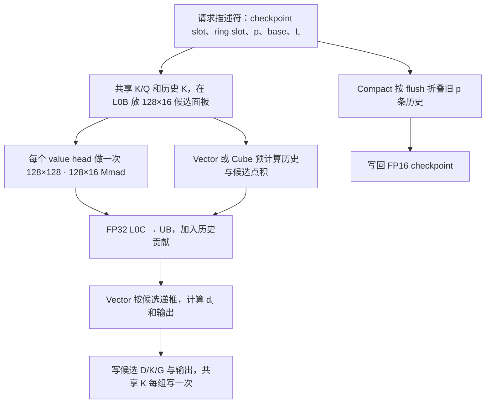

# Ascend 310P3 ReplaySSM SD 优化交接

更新于 2026-11-20。本文记录两套 kernel 的代码基线、已知性能、三算子重设计和下一轮上机验收方法。讨论期间完成了源码梳理、主机代数验证和游标状态枚举。下面的设备时延来自仓库已有记录，重设计和 FP16 消融需要在 310P3 上验证。

## 从哪一版接手

- **RGDR 替换 kernel**使用 `GoodThaumiel/ascend310p-rgdr-patch` 的 `main@3a3c4b0`。当前性能基线是 `rank1-gather16-interleave`，在 profiling CLI 中对应 `--variant baseline`，实际 kernel 名是 `rgdr_v310_cube_probe_rank1_gather16_interleave`。服务 wrapper 默认调用 `probe=0` 的 packed grouped 入口。做服务对比时用 profiler 确认符号。[`README`](https://github.com/GoodThaumiel/ascend310p-rgdr-patch/blob/3a3c4b0/README.md) · [服务 wrapper](https://github.com/GoodThaumiel/ascend310p-rgdr-patch/blob/3a3c4b0/src/ascend310p_rgdr_patch/__init__.py#L175)
- **ReplaySSM SD**使用 `GoodThaumiel/vllm-ascend` 的 `replayssm-310@e7010be`。入口在 `experimental/replayssm_sd_310p_ascendc`。服务默认是 V12 Vector verify，`tile_v=64`、`status_variant=1`，配 `tile_v=32` 的 compact variant 1 和单核 cursor。Verify 和 compact 的服务核数参数为 7。已经有两条实验路径，`d314220` 的整窗 Cube verify 对应 `status_variant=2`，`e7010be` 的批量 FP32 compact 对应 `compact_variant=2`。现有 Cube verify 支持 MTP3/7、HK8/HV16，`tile_v=64` 是 status ABI，内部使用完整 V=128。 [实验目录](https://github.com/GoodThaumiel/vllm-ascend/tree/e7010be/experimental/replayssm_sd_310p_ascendc) · [服务入口](https://github.com/GoodThaumiel/vllm-ascend/blob/e7010be/vllm_ascend/_310p/ops/replayssm_sd.py#L11)
- **原生 RGDR**可作为对照。V310 按 V 分片，用 Vector 求 `H'k`、更新状态，再求 `H_new q`。在 patch 的 profile 中对应 `--variant native`。 [原生 V310 实现](https://github.com/GoodThaumiel/vllm-ascend/blob/e7010be/csrc/attention/recurrent_gated_delta_rule_v310/op_kernel/recurrent_gated_delta_rule_v310.h#L399)

## 310P3 约束

- **每核 UB 和 L0C 各 256 KiB，L0A/L0B 各 64 KiB，L1 为 1 MiB。** Cube 和 Vector 在同一 AI Core 上的阶段共用该核 UB。下文的容量均为单核显式载荷或源码 `InitBuffer` 合计，CCE 实际分配还需上机核对。容量来源是本地 CCN 310P skill 的 `Ascend310P3.json` 中 `AICoreSpec`，UB 核算参考 `unified-core-ub-budget.md`。
- **L0C→UB 用增强 `DataCopy`。** 可直接搬出 FP32，也可随路做 FP32→FP16、标量或向量量化及 ReLU。量化模式包括 `DEQ/VDEQ`、`DEQ8/VDEQ8` 和 `DEQ16/VDEQ16`，源和目标 dtype 受各模式约束。310P 支持 FP16 输入配 FP16 或 FP32 Mmad 输出。 [增强搬运与类型表](https://www.hiascend.com/document/detail/zh/CANNCommunityEdition/850/API/ascendcopapi/atlasascendc_api_07_0104.html) · [Mmad 类型表](https://www.hiascend.com/document/detail/zh/CANNCommunityEdition/83RC1alpha003/API/ascendcopapi/atlasascendc_api_07_0249.html)
- **GM 原子写回。** 底层 `VECOUT → GM` 的 `SetAtomicAdd<T>()` 支持 FP16、FP32 和 INT16，310P 的这条路径不支持 `SetAtomicMax/Min` 或 INT32/INT8 原子加。SD 的 status 和 ring 写回按 32 B 块指定唯一写者。 [CANN 原子加](https://www.hiascend.com/doc_center/source/zh/CANNCommunityEdition/910beta3/API/ascendcopapi/atlasascendc_api_07_0210.html)
- **Scalar 成本。** 本地 CCN 310P skill 的 `shared/blocks/nd-to-zn-scatter/benchmarks.yaml` 记录了 310P3 单核 FP16 ND→ZN scatter，约 **12.15–12.18 cycles/元素**，含 UB `GetValue`、`SetValue`、下标和循环。128×256 用时约 368 µs。纯算术延迟和吞吐仍缺逐指令测量。评估批量发射时看 Scalar 和各流水的实测时间。

## RGDR grouped interleave 的计算与调度

一个 `(request, key head)` task 推进两个 value head。整窗加载 Q/K、两头 V 和门控，按 accepted slot 读取两份 FP16 状态。每候选对每头做一次 `128×144 · 144×16` Mmad，两头共享 K/Q 所在的 RHS。额外一段 K 维装入 V，RHS 对应位置置 −1，于是一次计算得到 `H'k−v` 和 `H'q`，其中 `H'=exp(g)H`。

```text
d     = −β · (H'k − v)
out   = scale · (H'q + d · (kᵀq))
H_new = H' + d · kᵀ
```


顺序是发 head 0 的 Mmad、读回 FP16 L0C 并缩放 `d₀`、发 head 1 的 Mmad、做 head 0 的 rank-1 更新、读回并更新 head 1、连续写回两个输出和两个候选状态。复用状态或输出 UB 前等 MTE3 完成。Gather 只把每个 delta 展开成一个 32 B 块，共 16 个 FP16 lane，靠 repeat stride 重用该块和整行 K。独立计算的乘积再加到 FP16 state。融合 `MulAddDst` 和 L0C 调度属于另列的消融。

每核 L1 A/B 为 36/4.5 KiB，L0A/L0B 同样为 36/4.5 KiB，单份 FP16 L0C/CO2 各 4 KiB。UB 的主要分配是两头状态 64 KiB、乘积 32 KiB、delta 与 Gather 偏移 12 KiB。HK8 情况下显式 UB 合计 W4 为 128.5 KiB，W8 为 132.75 KiB。 [实现](https://github.com/GoodThaumiel/ascend310p-rgdr-patch/blob/3a3c4b0/native-src/kernels/rgdr_cube_grouped_fp16.cpp#L213)

历史设备记录的条件是 B32、HK8、8 核、graph、CANN 9.1.0-beta.1。W4/W8 的交错路径 task p50 为 **875.2 / 1631.8 µs**，历史逐 head 路径为 **1156.4 / 2209.8 µs**。这组差值同时包含紧凑广播和调度变化。 [测量记录](https://github.com/GoodThaumiel/ascend310p-rgdr-patch/blob/3a3c4b0/README.md#L333)

## ReplaySSM SD 的状态契约

```text
上一轮 accepted / reset
    → Cursor 生成本轮 p、base、flush
    → Verify 读取 checkpoint 与旧历史，写本轮输出和候选 D/K/G
    → Compact 对 flush 行折叠旧历史，写 checkpoint
    → 下一轮用 accepted 选出候选的已接受前缀
```

`W` 是物理候选窗宽，MTP3/5/7 对应 W4/6/8。`L≤W` 是实际候选长度，`p≤16` 是已接受、待折叠的历史长度。ring 有 32 槽，checkpoint slot 和 ring slot 独立。旧历史写入位置按 `(base+i) mod 32` 解释，本轮候选从 `(base+p) mod 32` 开始。两头共享 K，D/G 分头存放。checkpoint、D/K 和输出存 FP16，G 存原 FP32 log-gate。Verify 保留同一轮内部的 FP32 delta，compact 只折叠旧 `p` 条。padding 输出清零，非法元数据遵循现有 status 语义。 [CPU 参考实现](https://github.com/GoodThaumiel/vllm-ascend/blob/e7010be/experimental/replayssm_sd_310p_ascendc/reference.py)

### 1. Cursor 批量产生本轮描述符

持久游标采用每个 ring slot 一个 32 B 对齐记录。按请求批量读取 accepted、reset、slot 和长度，每个请求一次更新持久记录并直接产出 `checkpoint slot / ring slot / p / base / L / flush`。先保留单核，比较改动能省下多少 32 B 读改写和 builder 里的三次 `index_select`。后续用固定容量的 flush 行列表减少 compact 在无折叠行上的扫表成本，同一 ACL Graph 可用设备侧有效条数处理动态负载。 [当前 cursor](https://github.com/GoodThaumiel/vllm-ascend/blob/e7010be/experimental/replayssm_sd_310p_ascendc/kernels/cursor.cpp#L35) · [builder](https://github.com/GoodThaumiel/vllm-ascend/blob/e7010be/vllm_ascend/ops/gdn_attn_builder.py#L538)

单独消融 **`flush = (p + L > 16)`**。现有策略是 `p + 2W > 16`，W8 时只要 `p>0` 就触发 flush。新条件下，无 flush 时下轮接受 `n≤L` 可保证 `p+n≤16`。发生 flush 后，`base` 前移旧 `p`，新历史从本轮接受的前缀开始。旧历史与本轮候选合计最多 24 槽，跨尾仍不重叠。

主机穷举 **36,448 个状态转换**，覆盖 W4/6/8、全部 base、各 p/L 和 `1≤n≤L`。落地还需确认已执行 compact 后实际 `accepted=0` 的状态机语义，将其与停走或 padding 区分，避免二次折叠。推迟 flush 可减少 checkpoint 重复写回和半精度舍入的次数，同时会拉长 Verify 的历史。用服务采样的 p/L 分布比较净收益。

### 2. Verify 用 Cube 计算整窗投影，Vector 做递推

V12 目前按状态块将相邻 value head 分给同一个核。每头先算候选和历史 dot 表，两片 V=64 tile 依次使用该表，tile 内逐候选做 checkpoint matvec 和历史修正。W4/W8 显式 UB 约为 111.28/118.28 KiB。整窗 Cube 实验已有完整 V=128 路径，显式 UB 约 87.66 KiB。



1. 每 `(request, key head)` 准备一次 `B=[K_windowᵀ | Q_windowᵀ]`，固定 16 列，短窗补零。每个 value head 计算 `H_checkpoint × B`。每头 L0A 为 32 KiB，双头共享 4 KiB L0B，FP32 L0C 和读回的 UB tile 各 8 KiB。
2. 长历史用同一 L0B 计算 `T=[K_history; K_window] × B`，最多 24 行，补到 32 时需要 8 KiB L0A 和 2 KiB FP32 L0C。短历史用现有 Vector dot 做对照。
3. Vector 把历史贡献加到投影 `P₀`。对候选 t，只取 `k_t`、`q_t` 两列，乘本窗门控，再加入此前候选的 `d_j · T[j,列] · 后续门控积`。从 K 列计算 `d_t=β_t(v_t−P_k)`，Q 列加上当前 `d_t(k_tᵀq_t)` 后缩放输出。各段门控直接连乘。W4 优先测按列更新，W8 与现有整块投影更新比较发射和 Vector 成本。192 组主机 FP64 用例与完整状态递推的最大绝对差约为 `1.1e-16`。
4. 调度顺序先试 `提交₀ → 读回₀ → 提交₁ → Vector₀ → 读回₁ → Vector₁`。独立保留 head 0 的 UB 投影，一个 L0C 槽即可开始试验。D 与输出按窗聚集写回，共享 K 只写一次。用 trace 检查实际重叠、源 buffer 重用和 MTE3 完成事件。对照不同变体时保持 status 块的单写者约束。

[V12 分配与递推](https://github.com/GoodThaumiel/vllm-ascend/blob/e7010be/experimental/replayssm_sd_310p_ascendc/kernels/verify_common.cpp) · [Cube 试验版](https://github.com/GoodThaumiel/vllm-ascend/blob/e7010be/experimental/replayssm_sd_310p_ascendc/kernels/verify_cube.cpp)

### 3. Compact 把多次外积合并为短 K GEMM

现有 variant 1 以 V=32 tile 按历史顺序逐条缩放和做外积，重路径 UB 约 48.66 KiB。variant 2 按 `(row,key head)` 分任务，两头共享 K，K/D 跨尾最多两段读，完整 V=128 的重路径显式 UB 约 216.5 KiB。仓库记录的 B128、16 条历史全 flush 时，旧 compact 约 **33.86 ms**，占当时 Cube 验证组合图 **79%–82%**。此数据用于压力测试，线上收益取决于 flush 和 p 的实际分布。

```text
α_i          = exp(g_i)
w_i          = ∏_{j>i} α_j
D_weighted   = [w_0 d_0, …, w_{p−1} d_{p−1}]
H_new        = (∏ α_i) · H_checkpoint + D_weighted · K_history
```

- 短历史以批量 FP32 Vector 为起点。用 **每行 8 个 FP32 lane** 的紧凑 delta 和 repeat stride，替换展开整个矩阵的广播。保持原 Mul/Add 次序做第一次消融，再独立测 `MulAddDst`、UB bank 位置和融合舍入。
- 长历史试 V=64 分片，`64×16 · 16×128`。FP16 加权 D 占 2 KiB L0A，FP16 历史 K 占 4 KiB L0B，FP32 增量占 32 KiB L0C。Cube 计算时预取 checkpoint，增量读回 UB 后与同布局的 FP32 衰减 checkpoint 相加，再一次转 FP16 写出。扫 `p=1…16` 确定切换点。加权 D 转半精度误差超限时，可对比 FP32 Vector 和两份 half 分解的两次 Mmad，第二次累加到同一份 FP32 L0C。

[variant 1](https://github.com/GoodThaumiel/vllm-ascend/blob/e7010be/experimental/replayssm_sd_310p_ascendc/kernels/compact.cpp#L238) · [variant 2](https://github.com/GoodThaumiel/vllm-ascend/blob/e7010be/experimental/replayssm_sd_310p_ascendc/kernels/compact_batch.cpp#L135) · [实测与验收](https://github.com/GoodThaumiel/vllm-ascend/blob/e7010be/experimental/replayssm_sd_310p_ascendc/CUBE_GROUPED_REDESIGN.md#L209)

## FP16 消融顺序

1. **Verify 单独改变投影精度。** 同一调度比较 `FP16×FP16 → FP32 L0C → FP32 UB`、FP32 L0C 随路转 FP16 UB、FP16 L0C 直接读回。半精度 `128×16` 从 8 KiB 降到 4 KiB，每行对应一个 32 B block。先在使用时转回 FP32，保持历史修正和 `v−P_k` 的精度。残差相消会放大投影误差，delta 误差还会进入本轮后续递推和下一轮 ring。
2. **Compact 先用 FP16 乘法、FP32 累加。** `exp(g)`、后缀积和 checkpoint 相加留在 FP32。加权 D 转 FP16 后上 Cube，L0C 先保留 FP32。放宽 L0C 精度作为独立实验。
3. **Cursor 维持整数，G 保留 FP32。** 很小的衰减在 FP16 下可能舍入成 1，多步连乘会丢失这部分衰减。

## 下一轮上机交付

1. **先复现现有代码。** 用同卡和同一 CANN 构建完整实验库，跑 MTP3/7 的 `smoke`、`sequence`、`graph`。以 **Cube verify + compact 1** 对比 **Cube verify + compact 2**，隔离 compact 的收益。V12 服务路径作为另一个组合对照。现有运行器在实验目录的 `run.py`，指定 `--status-variant 2 --tile-v 64` 选择 Cube verify，`--compact-variant 1/2` 选择 compact。 [构建与运行命令](https://github.com/GoodThaumiel/vllm-ascend/blob/e7010be/experimental/replayssm_sd_310p_ascendc/CUBE_GROUPED_REDESIGN.md#L115)
2. **用真实分布和压力用例决定优先级。** B32/B64/B128 × MTP3/7，分别测 `cold`、`mixed`、`full_flush`。记录 L/p 直方图、flush 行数、折叠条目总量和 checkpoint 流量。先单独比较 flush 策略，再按 trace 选择短 K compact、共享 dot 上 Cube 或 head 交错。MTP5 保留 V12 回归。
3. **正确性跨轮检查。** 检查输出、D/K/G、checkpoint、status、下一轮投影和 accepted。覆盖短窗、空历史、p=16、跨尾、混合 flush、独立 slot、reset 与 slot 复用。纯调度消融从逐位比对起步，改变运算顺序或精度时，报告误差、最差 case 及多轮接受变化。
4. **留同口径性能证据。** 给出三个 kernel 和同图组合的 p50/p90，以及 Scalar、Vector、MAC、MTE 与事件 trace。记录实际目标符号、核数、设备/CANN、commit 和计时来源。最终用同显存预算下的服务输出 tokens/s、有效并发、TPOT 验收。
